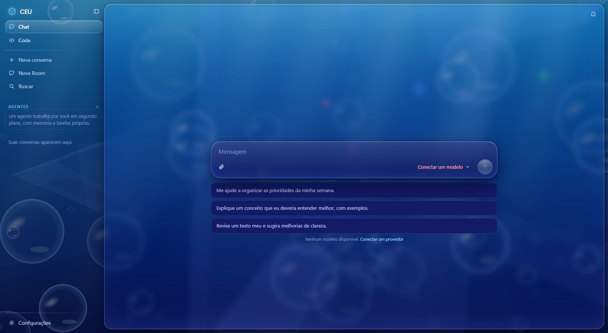

<p align="center">
  
</p>
<h1 align="center">CEU</h1>
<p align="center"><strong>Composable Experimentation Unit</strong><br>
A local workspace for conversations, code, and experiments with AI participants.</p>
<p align="center">
  <a href="LICENSE">MIT</a> · <a href="#quick-start">Quick start</a> ·
  <a href="#try-it">Try it</a> · <a href="docs/limitations.md">Known limitations</a>
</p>

CEU brings several models into one workspace: talk to one, invite another into the
conversation, arrange a Room, or hand a concrete task to Code or a persistent Agent.
It is a place to experiment with how models work together, while keeping the
application state on your computer and approvals visible in the conversation.

**Early experimental source release.** Windows is the tested platform. The UI is
in **English by default**, with **Brazilian Portuguese** available in
**Settings → General → Language**. The legacy Chat UI remains in Portuguese.
Bring an API key or a local OpenAI-compatible model
server; CEU includes neither models nor API credits. Remote providers receive the
context you send them. A standalone desktop installer is not ready.



<p align="center"><sub>Actual first-run browser UI, captured with an isolated empty database. No account or personal data.</sub></p>

## What you can explore

| Surface | What it does | Status |
| --- | --- | --- |
| **Chat** | Stream replies, switch models, branch conversations, attach files, search and export history | Core path; automated tests use simulated providers |
| **Participants & Rooms** | Call another model with `@`; run a fixed sequence of participants across rounds | Experimental, integration-tested |
| **Code** | Work in a chosen folder with file tools, commands, approvals, tracked edit undo and steering | Experimental; commands run on your computer |
| **Agent** | Keep notes, schedule tasks, park approvals, delegate work and track open issues | Experimental; backend must remain open |
| **Runtimes** | Use CEU's own loop or optional Codex, Claude and supervised CLI integrations | Optional; vendor installation/login required |

The original product direction lives in [BRIEF.md](BRIEF.md) (pt-BR).
See [release scope and limitations](docs/limitations.md) for exact boundaries.

## Requirements

- **Python 3.10+**, with pip and venv.
- **Node.js 20.19.x or newer 20.x, or 22.12+**, and npm, for the full React UI.
  Node 21 and early Node 22 are unsupported by the frontend toolchain.
- A modern browser and an API provider or local model endpoint.
- **Git**, for Code's Git tools and repository-related coordination.

Optional: WSL2 on Windows for Chat's code-execution tool; Rust 1.90+, MSVC Build
Tools and WebView2 for the [Tauri shell](web-app/README.md). None is needed for
ordinary browser Chat with an API provider. Core Code file/command tools run on
the host and do not require WSL2.

## Quick start

Clone the repository using its GitHub **Code** button, or download and extract
the source ZIP. Open a terminal in the extracted repository root, where this
README and `requirements.txt` live.

### Windows (PowerShell)

```powershell
python -m venv .venv
.\.venv\Scripts\python.exe -m pip install -r requirements.txt
cd web-app
npm ci
npm run build
cd ..
.\.venv\Scripts\python.exe -m server.main
```

Open **[http://127.0.0.1:4747](http://127.0.0.1:4747)**. Keep the terminal open;
press `Ctrl+C` to stop. No environment activation, Rust or desktop build is needed.
If `python` is unavailable but the Windows launcher is installed, use
`py -3 -m venv .venv` for the first command.

After setup, you can use **`start.bat`**. It prepares/retries Python dependencies,
reuses an existing CEU server, or starts one and opens a browser window when ready.
It does not build React: run the frontend build above first for the full UI.

### macOS / Linux (unverified)

```sh
python3 -m venv .venv
.venv/bin/python -m pip install -r requirements.txt
cd web-app
npm ci
npm run build
cd ..
.venv/bin/python -m server.main
```

These are the portable browser/backend commands; platform-specific integrations
may be unavailable. This release was validated on Windows only.

### Python-only fallback

Skip the Node/build steps to run the older, limited Chat UI in `web/`.
It does **not** expose Code, Agent or the new coordination interface. After a
React build exists, Python serves it automatically; `--web legacy` explicitly
selects the fallback. Rebuild and restart after updating the frontend source.

## Try it

1. Open **Configurações → Provedores** and add Anthropic, OpenAI, OpenRouter or
   an OpenAI-compatible endpoint. API keys go to the local backend. If automatic
   discovery fails, check the URL/key and add an exact model ID manually.
2. For a local server, choose **Local**, enter its `/v1` base URL (for example,
   `http://127.0.0.1:11434/v1`), and select an already installed/loaded model.
   CEU does not download or start models. First startup probes common local ports.
3. Select a model and send: **“Explique este projeto em três pontos.”**
4. With two models configured, type `@` in the composer to invite another
   participant. Create a Room to compare a fixed sequence of replies.
5. For Code, choose **Code**, select a disposable project folder, keep the
   **Manual** permission mode, and ask: **“Leia os arquivos e descreva a estrutura.
   Não altere nada.”** Review approval requests before allowing edits or commands.

Agent tasks, runtime integrations and GitHub tools are optional. Start with Chat;
see [runtime notes](docs/runtimes-code.md), [coordination](docs/coordenacao.md) and
[Git/GitHub](docs/git-github.md) (pt-BR) when exploring further.

## Configuration and data

CEU stores conversations, attachments, settings, manual memory and **provider API
keys in plaintext SQLite** under `data/`. GitHub tokens use the OS secret store;
external runtimes keep their own login state. API responses hide provider keys,
but a database backup is still sensitive. See [SECURITY.md](SECURITY.md).

`.env.example` is a reference. **CEU does not automatically load `.env` files.**
Configure providers in the UI or export `ANTHROPIC_API_KEY` / `OPENAI_API_KEY`
before first startup. Environment seeding runs when no provider exists.
Titles and starter suggestions can make additional model calls and incur charges.

| Variable | Default | Purpose |
| --- | --- | --- |
| `CEU_PORT` | `4747` | Python backend port; `--port` overrides it |
| `CEU_API_PORT` | `4747` | Vite's backend proxy target during development |
| `CEU_DATA_DIR` | repository `data/` | Separate storage directory; prefer an absolute path |
| `CEU_LOG` | unset | Any nonempty value enables local HTTP logs |
| `CEU_ROOT` | checkout in development | Source checkout used by the optional desktop shell |
| `CEU_SANDBOX_DISTRO` | `ceu-sandbox` | Optional WSL2 distro name |
| `CEU_SANDBOX_DIR` | user-local CEU sandbox folder | WSL2 provisioning files |

The server listens on loopback and has **no authentication**. Keep it local.
Only one backend may use a data directory at a time. For another development
instance, use a separate `CEU_DATA_DIR` and `--port`. The browser build follows
the serving origin; Tauri requires port 4747.

## Architecture

```text
React browser UI / optional Tauri shell / legacy Chat UI
                         │  HTTP + SSE
                 Python ThreadingHTTPServer
                         │
       generation + providers + local SQLite/event history
                         │
       calls / Rooms / Code tools / Agent coordination
                         │
          model APIs, local servers, optional CLIs
```

[`server/`](server/) contains the backend; [`web-app/`](web-app/) the React UI and
Tauri shell; [`web/`](web/) the no-build Chat fallback; [`scripts/`](scripts/)
local checks and release tooling. Read [architecture](docs/architecture.md) for
module responsibilities and the reconnection/recovery model.

## Development and validation

Run the Python backend in one terminal. In another:

```powershell
cd web-app
npm ci
npm run dev
```

Open `http://localhost:5173`. For a different backend port, set `CEU_API_PORT`
before launching Vite. Use the Python server for the built application;
`npm run preview` alone does not provide the CEU API.

Validate the source release from the repository root:

```powershell
.\.venv\Scripts\python.exe scripts/release.py --dry-run --skip-tauri
```

This checks backend compilation, isolated startup/security regressions, calls,
Rooms, coordination, Git tools, recovery, frontend lint and production build.
No live model account or remote GitHub operation is required. Omit `--skip-tauri`
to also check the optional desktop bundle with its prerequisites installed.
`--dry-run` does not change versions or create commits/tags.

See [CONTRIBUTING.md](CONTRIBUTING.md) and the [local release audit](docs/release-audit.md)
for validation evidence and remaining gaps. No provider or runtime is claimed
stable solely because a fake-provider test passes.

## Troubleshooting

| Symptom | What to check |
| --- | --- |
| Only the older Chat interface appears | Run `npm ci` and `npm run build` in `web-app/`, then restart Python without `--web legacy` |
| No models / authentication error | Configure a provider, verify its URL and key, or start/load your local model server |
| Backend says another instance uses the data | Reuse the existing server, stop it first, or choose a separate data directory and port |
| Port already in use | Run `python -m server.main --port 4748` and open that port; update `CEU_API_PORT` for Vite |
| Python dependency install fails | Check Python version and network access, then rerun the pip command; `start.bat` also retries |
| An optional runtime is unavailable | Install/log in to the vendor tool in **Configurações → Runtimes**; regular API Chat does not need it |

## License

CEU is licensed under [MIT](LICENSE). Bundled third-party code retains its own
licenses; see [THIRD_PARTY_NOTICES.md](THIRD_PARTY_NOTICES.md).
